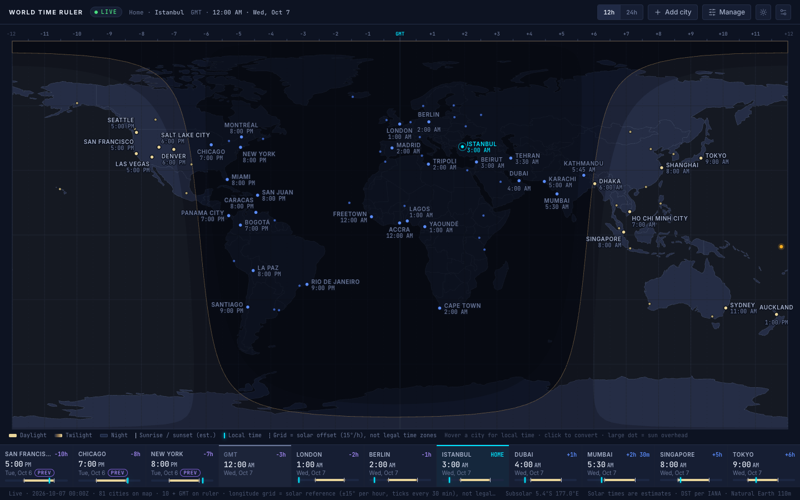

# World Time Ruler

[](https://github.com/babushka99/world-time-ruler/actions/workflows/ci.yml)
[](LICENSE)

A free, open-source Chrome extension that shows world time on a live day/night map, with a ruler
of your saved cities and time-zone-correct planning conversions. Works fully offline: no server,
account, API key, tracking or network request.



## Install

### Option A — download the ready-made extension (no tools needed)

1. Go to the [**Releases** page](https://github.com/babushka99/world-time-ruler/releases/latest)
   and download `world-time-ruler-<version>.zip`.
2. Extract it to a permanent folder (Chrome reads the files from there every time it starts — do
   not delete or move the folder afterwards).
3. Open `chrome://extensions` in Chrome.
4. Turn on **Developer mode** (top-right switch).
5. Click **Load unpacked**.
6. Select the `world-time-ruler` folder — the one that contains `manifest.json`.
7. Click the puzzle-piece icon in the toolbar and **pin** World Time Ruler.
8. Click its icon. World Time Ruler opens in its own tab.

Works in Chrome 120+ and other Chromium browsers (Edge, Brave, Arc, Opera, Vivaldi).

### Option B — build it yourself

See [Rebuild from source](#rebuild-from-source) below.

## Use

| Control | What it does |
|---|---|
| Toolbar icon | Opens World Time Ruler in a new, active tab (one new tab per click). |
| **12h / 24h** | Switches every time on the page. Saved. |
| **Add city** | Search ~6,000 cities by name, country or IANA zone. The zone and current offset are shown so same-named cities can be told apart. Adds to the ruler and the map. At ten cities it asks which saved city to replace (or sends you to Manage to remove one). Duplicates are refused. |
| **Manage** | Saved cities west → east. Radio button = home. ✕ removes a city; removing the home city first asks for a replacement home. At least one city is always kept. Each saved city has a **Label** switch, and the **Map labels** list below shows every other dot on the map (71 by default) with the same switch: on names the dot with its time, off leaves it as a plain dot. |
| Sun / moon button | Dark ↔ light theme. Saved. |
| Settings (sliders icon) | Time format, theme, and **Reset…** (asks for confirmation) back to the ten default cities, Istanbul as home, 12h, dark. |
| Hover / focus a city | Tooltip: local time and date, difference from home, IANA zone, UTC offset, estimated sunrise/sunset, GMT. |
| Hover / focus the large amber dot | The sun marker: where the sun is directly overhead right now (the subsolar point). It is not a city; the tooltip shows its coordinates and GMT. |
| Click a map city or ruler cell | Opens **Convert from**. Enter a date (`YYYY-MM-DD`) and time *in that city*, then **Apply** (or Enter). Esc or Cancel closes it. |
| **Back to now** | Leaves Planning mode and returns to the live clock. |

**Live** mode follows the real clock: it re-reads the time at every minute boundary and immediately
when the tab becomes visible again. **Planning** mode freezes everything — ruler, map labels,
day/night boundary, sun marker, GMT readout — at the instant you entered, until you change it or
click *Back to now*. Choosing a conversion source never changes your home city.

Daylight-saving edge cases are never guessed:

* A time that happens twice (clocks set back, e.g. New York 1:30 AM on 1 Nov 2026) shows both
  occurrences with their UTC offsets; you pick one before Apply is enabled.
* A time that does not exist (clocks set forward, e.g. New York 2:30 AM on 8 Mar 2026) is rejected
  with the skipped range ("clocks jump from 2:00 AM to 3:00 AM") and you are asked for a valid time.

Reading the screen:

* Twenty-nine extra cities are labelled on the map with their name and local time without taking
  a ruler slot: Santiago, San Juan, Montréal, Rio de Janeiro, Madrid, Beirut, Tehran, Ho Chi Minh
  City, Shanghai, Tripoli, Freetown, Yaoundé, Bogotá, Panama City, La Paz, Caracas, Miami, Denver,
  Salt Lake City, Las Vegas, Seattle, Lagos, Accra, Karachi, Kathmandu, Dhaka, Sydney, Auckland and
  Cape Town (the list is `MAP_LABELLED` in `src/lib/cities.ts`). Hovering or clicking them works like
  any other city; adding one to the ruler simply makes it a ruler city. Every other map dot can be
  given a label from **Manage → Map labels**, and any label can be switched off there.

* The ruler is sorted by each city's actual UTC offset at the displayed instant, so the order
  changes with daylight saving. Differences and PREV / NEXT date badges are relative to home.
* The numbers across the top of the map (−11 … GMT … +11) are a **solar reference**: 15° of
  longitude per hour, ticks every 30 minutes. They are **not** legal time-zone boundaries.
* Sunrise, sunset, twilight and the day/night boundary are **estimates** (typically within a couple
  of minutes at mid latitudes; no terrain or local refraction).
* Below 1100 px wide the ruler wraps to two rows (three below 620 px) instead of dropping or
  scrolling cities; the footer shows "compact ruler".

Settings, saved cities and home are stored in `chrome.storage.local` on this device. They survive
browser restarts and extension updates and are shared live between all open World Time Ruler tabs.

## Permissions and privacy

Only `storage`. No `tabs`, `activeTab`, `scripting`, history, geolocation or host permissions; no
popup; the New Tab page is not replaced. The page's content security policy is
`default-src 'self'; script-src 'self'; connect-src 'none'; …` — no inline script, no `eval`, no
remote code, and outbound connections are blocked outright.

## Rebuild from source

Requires Node.js 22.12+ (built with Node 26, npm 10).

```sh
npm ci            # install exact dependency versions from package-lock.json
npm test          # unit tests (time zones, DST, solar, storage rules, search)
npm run build     # typecheck + bundle → dist/world-time-ruler/ and dist/world-time-ruler-<version>.zip
npx playwright install chromium   # once, for the browser tests
npm run test:e2e  # loads the built extension into Chromium and drives it
```

Other scripts: `npm run dev` (plain web preview at localhost; uses localStorage instead of
chrome.storage, toolbar behaviour not available), `npm run data:cities` (regenerate
`src/data/cities.json` from the GeoNames files in `data-src/`), `npm run icons` (redraw the PNG icons).

To publish a new version: bump `version` in `public/manifest.json` and `package.json`, add an
entry to `CHANGELOG.md`, commit, then push a matching tag (`git tag v1.2.0 && git push --tags`).
GitHub Actions builds the extension and attaches the ZIP to a new release on the Releases page.

To update an installed copy: replace the contents of the installed folder with the new
`world-time-ruler` folder, then press the reload arrow on the extension's card in
`chrome://extensions`. Saved settings are kept.

### Layout

```
public/manifest.json, public/icons/     extension manifest and 16/32/48/128 px icons
src/background.ts                       service worker: action click → chrome.tabs.create(chrome.runtime.getURL('index.html'))
src/lib/time.ts                         IANA conversion (bundled Temporal), gap/overlap detection, formatting, input parsing
src/lib/solar.ts                        subsolar point, altitude, sunrise/sunset/twilight per local date (SunCalc)
src/lib/mapgeo.ts, labels.ts            projection, day/night geometry, label placement
src/lib/cities.ts, src/data/cities.json bundled city dataset + search
src/lib/prefs.ts, storage.ts            saved-city rules, chrome.storage.local persistence and tab sync
src/components/                         map, ruler, tooltip, editor, Add city / Manage / Settings panels
tests/unit, tests/e2e                   automated checks
scripts/                                dataset, icon, notices and zip generators
design/                                 the original design handoff (reference only; not shipped)
```

## Troubleshooting

* **"Manifest file is missing or unreadable"** — you selected the wrong folder. Pick the folder that
  directly contains `manifest.json` (`world-time-ruler`), not its parent and not the ZIP.
* **The icon is not in the toolbar** — click the puzzle-piece icon and pin World Time Ruler.
* **Extension disappeared or shows an error after a restart** — the folder was moved, renamed or
  deleted. Put it back (or Load unpacked again from its new place). Chrome ties an unpacked
  extension's saved data to its folder path, so loading from a *different* path starts with
  default settings; keeping the same path keeps your cities.
* **Chrome shows a "Disable developer mode extensions" prompt at start-up** — normal for unpacked
  extensions; dismiss it. Managed (work) Chrome profiles may block Load unpacked entirely.
* **Settings were not saved** — check that the card in `chrome://extensions` shows no errors, then
  press its reload arrow. Incognito windows only run the extension if "Allow in Incognito" is on.
* **A time looks wrong for a country that recently changed its clock rules** — zone rules come from
  Chrome's built-in IANA database; update Chrome.
* **Blank map** — press the reload arrow on the extension card, then reopen the tab. If it
  persists, open DevTools (F12) on the tab and check the Console.

## Test results

See `TEST_RESULTS.md`.

## Contributing

Bug reports, ideas and pull requests are welcome — see [CONTRIBUTING.md](CONTRIBUTING.md) and the
[Code of Conduct](CODE_OF_CONDUCT.md). Security issues: see [SECURITY.md](SECURITY.md).
Privacy: see [PRIVACY.md](PRIVACY.md) (short version: nothing is collected).

## License

World Time Ruler is released under the [MIT License](LICENSE) — free to use, copy, change and
share, including commercially, as long as the copyright notice is kept.

## Credits and third-party licences

City data © GeoNames (CC BY 4.0); country outlines from Natural Earth (public domain) via
world-atlas; fonts Inter and JetBrains Mono (SIL OFL 1.1); icons Lucide (ISC); libraries React,
d3-geo, topojson-client, temporal-polyfill, SunCalc. Full texts: `THIRD_PARTY_NOTICES.txt`
(also inside the extension folder).
